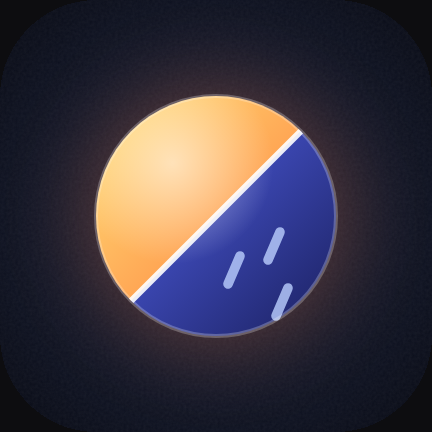
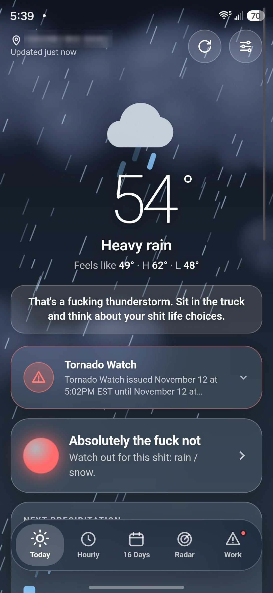
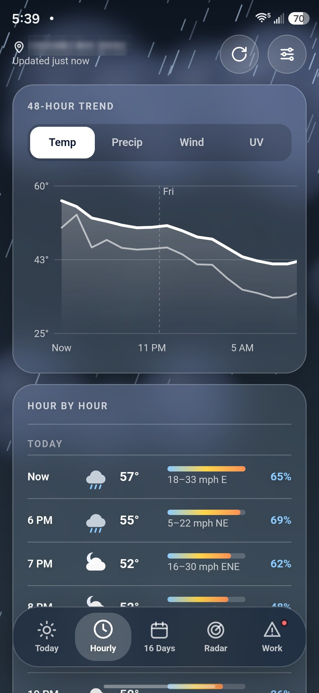
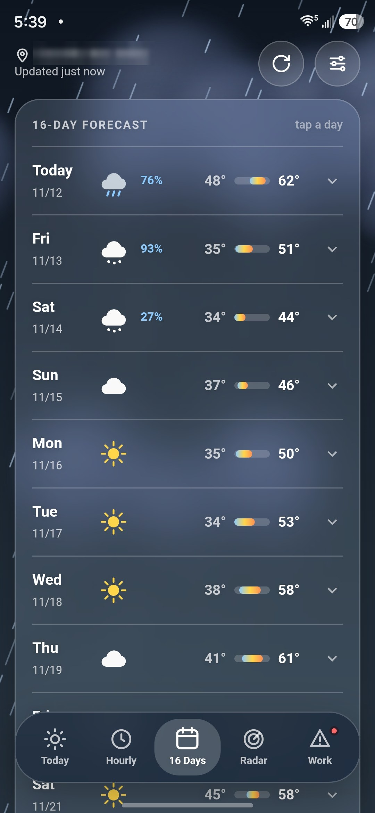
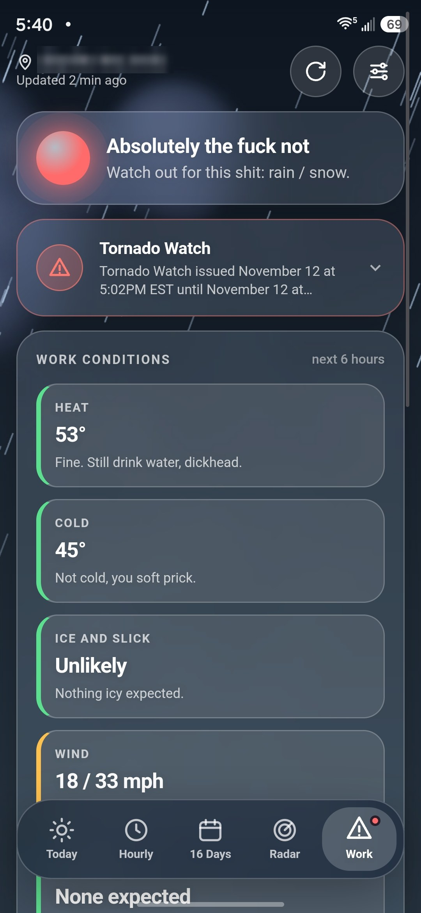
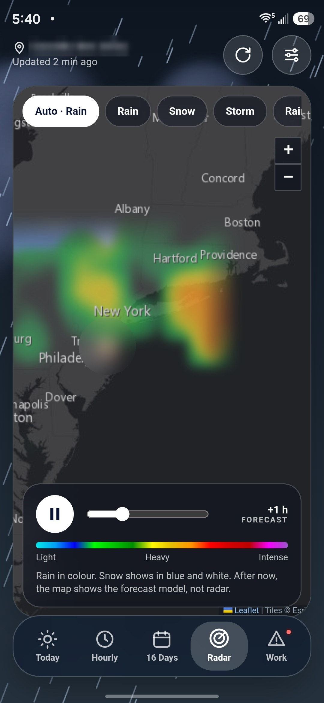

<p align="center"></p>

<h1 align="center">Weathered</h1>
<p align="center"><b>The weather app that tells you the truth, and then tells you to go fuck yourself.</b></p>
<p align="center"><i>Built for people who work outside. Not built for people with delicate feelings.</i></p>
<p align="center"><b><a href="https://rare621.github.io/Weatherd/">Website</a> · <a href="../../releases/latest">Download for Android</a></b><br><sub>A free, open-source, ad-free Android weather app for construction workers, tradespeople and outdoor workers, that also happens to swear at you.</sub></p>

<p align="center">
  
  
  
  
  
</p>

---

## Why does this exist?

Your phone's weather app says **"Rain likely, 60%."** Cool. Thanks. Very helpful.

Weathered says:

> **"That's a fucking thunderstorm. Sit in the truck and think about your shit life choices."**

One of those is going to keep you off a wet roof. It isn't the polite one.

Every other weather app was designed by someone who checks the forecast to decide whether to bring a cardigan to brunch. This one is for the people pouring concrete, hanging off ladders, running cranes and standing in a ditch at 6 AM wondering why they didn't become an accountant.

## Things it will say to you

Real lines from the app. We didn't make these up for the README. Well, we did, but then we put them in the app.

There are **over 160 of them**, 13 to 20 for every kind of weather, written for the poor bastards who work outside for a living, and it rotates through them through the day so you never get comfortable.

| When it's… | Weathered says |
|---|---|
| 🔥 Hot as hell | *"Hotter than Satan's ballsack. Drink some goddamn water before you pass out in an attic and they find you by the smell."* |
| 🥶 Freezing | *"Cold enough to snap your dick off. Not that anyone would notice it was gone."* |
| 🌧️ Raining | *"Mother Nature reviewed your performance and decided to piss all over it. Fair."* |
| ❄️ Snowing | *"Snow day for the kids. 'No heat' calls for you, sucker."* |
| 💨 Windy | *"Too windy for the lift, too windy for the ladder, never too windy for your boss to call asking where the fuck you are."* |
| ⚡ Storming | *"If you die up there, the company sends flowers and posts your job on Indeed the same afternoon. Get down, dickhead."* |
| 🌫️ Foggy | *"Visibility near zero, same as your chances of ever making foreman."* |
| ☀️ Perfect | *"Gorgeous day. Some guy at a desk is staring out his window feeling sorry for himself. Don't be smug, he makes double."* |

Tap the insult and you get a fresh one. Yes, you can ask to be insulted on demand. No, we won't judge you for doing it twelve times in a row. (We will.)

The big verdict at the top is one of three:

- 🟢 **Get to work, you lazy cunt**
- 🟡 **Pay attention, dickhead**
- 🔴 **Absolutely the fuck not**

That's the whole risk assessment. Your safety officer has a 40-page binder. This has three lines and is right more often.

## OK but is it actually a good weather app?

Annoyingly, yes. Under all the swearing it's a serious piece of kit:

- **Today**: Current conditions, feels-like, highs and lows, and *next precipitation down to 15 minutes*. Plus an animated sky that actually matches the weather: drifting clouds, rain, snow, sleet, hail, real branching lightning bolts, shooting stars, wind streaks. It's genuinely pretty. Don't tell anyone.
- **Hourly**: A 48-hour chart (temp, rain, wind, UV) and an hour-by-hour list. **Tap any hour** for every number you could want, a work verdict for that hour, and a fresh insult tailored to it.
- **16 days**: Because "next week" is apparently when your boss wants that slab poured.
- **Radar**: Two hours of live radar, then it **keeps going up to 12 hours into the future** using the forecast model. Smooth transitions, no jump cuts. It switches its colours on its own for rain, snow or storms, and flags hail.
- **Work**: Six-hour go / caution / stop checks for heat, cold, ice, wind, lightning, rain, visibility, UV and air quality. Plus **good working windows** for concrete, paint, roofing and cranes or lifts, so you can tell the GC "not until 2 PM" and have a screenshot to back it up.
- **Alerts**: Tornado watches, wind advisories and anything else the National Weather Service is yelling about (US).
- **Home screen widgets**: Small, hourly, and hourly plus 5 days. They update on their own about every 30 minutes, so your home screen can insult you too. Convenient!

## "I don't want my phone calling me a cunt"

Fair. Bit soft, but fair.

**Settings → Potty mouth → Off.** Every line switches to a clean version. The app gets noticeably less fun, but it stops being an HR incident, so you can hand your phone to your mom, your kid or your supervisor.

## Install

1. Grab the latest `Weathered.apk` from **[Releases](../../releases)**.
2. Open it on your Android phone (Android 8.0 or newer).
3. Let your phone install apps from outside the Play Store when it asks. It'll warn you. It's being dramatic.
4. Open the app, give it your location, and prepare to be disrespected.

## Privacy

- No accounts.
- No ads.
- No tracking.
- No API keys.
- No "personalized experience."

Your location goes to the free weather services below to fetch your forecast, and that's it. The only thing this app collects is your dignity.

## Build it yourself

Every push to `main` builds an APK with GitHub Actions and posts it to Releases. If you insist on doing it the hard way:

```sh
./gradlew :app:assembleDebug
```

The map library ([Leaflet](https://leafletjs.com/) 1.9.4) is downloaded during the CI build into `app/src/main/assets/leaflet/`. For a local build, drop `leaflet.js` and `leaflet.css` in there yourself, you big strong developer.

**How it's put together:** One web page (`app/src/main/assets/index.html`) running in an Android WebView, plus a small Kotlin bridge for location, links, status bar colours and the home screen widgets (`MainActivity.kt`, `Widgets.kt`). The insults live in a table in `index.html` and are generated into `Quips.kt` for the widgets. Pull requests with better insults will be reviewed with great enthusiasm.

## Data sources

The people who actually do the hard work, and who are much nicer than this app:

- Forecast, air quality and place search: **[Open-Meteo](https://open-meteo.com/)**
- Weather alerts: **[National Weather Service](https://www.weather.gov/)** (US only)
- Radar: **[RainViewer](https://www.rainviewer.com/)**
- Base map: Esri, HERE, Garmin, © OpenStreetMap contributors

## The serious bit

Forecasts are computer models, not promises, and radar can't tell hail from rain. The swearing is a joke; the lightning is not. Use your own judgement and your site's safety rules. If the sky is green and the app says "nice day," believe the sky.

## License

[GPL-3.0](LICENSE). Fork it, improve it, make it ruder.
